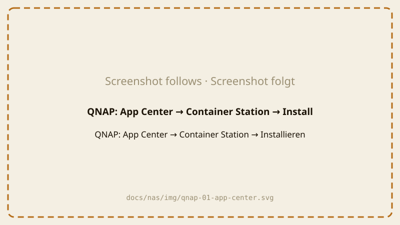
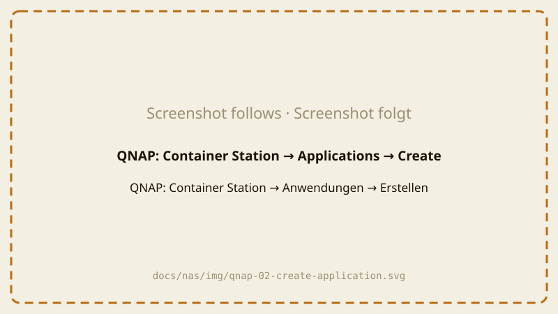
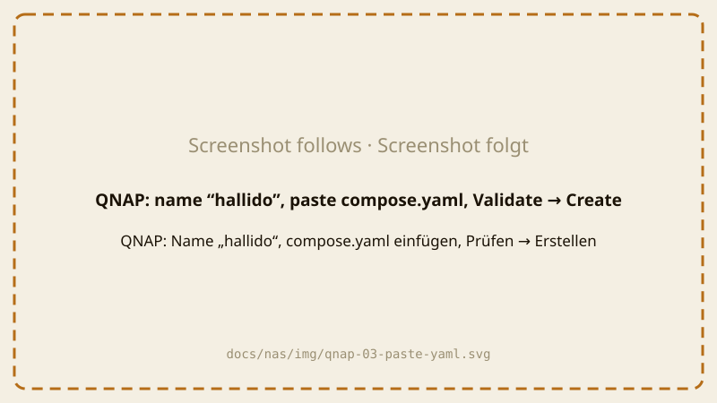
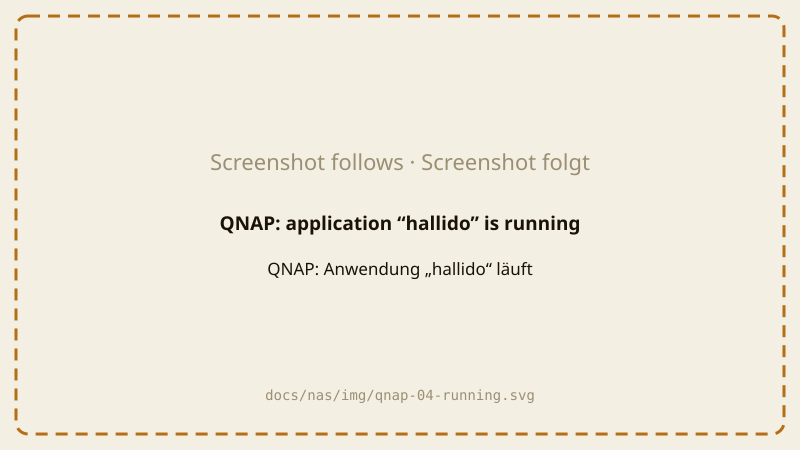
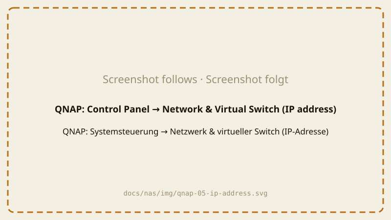

# Hallido auf einer QNAP-NAS installieren

Für QTS 5 / QuTS hero 5 mit Container Station 3. Dauert etwa 10 Minuten.

Du brauchst die Datei **`compose.yaml`** aus
[dem neuesten Release](https://github.com/ohm-meter/hallido/releases/latest)
auf deinem Computer ([was ist das?](README.md#die-drei-schritte)).

> Die Bilder sind Platzhalter und werden durch echte Screenshots ersetzt.

## Schritt 1: Container Station installieren

1. Melde dich im Browser als Administrator an deiner QNAP an.
2. Öffne das **App Center**.
3. Suche nach **Container Station** und klicke auf **Installieren**.
   Ist sie schon installiert, mach mit Schritt 2 weiter. Beim ersten Start
   fragt Container Station nach einem Ordner für ihre Daten – übernimm den
   Vorschlag.

## Schritt 2: Hallido-Anwendung anlegen

1. Öffne die **Container Station**.
2. Klicke links auf **Anwendungen** und dann auf **Erstellen**.

   

3. Fülle das Formular aus:
   - **Anwendungsname:** `hallido`
   - Öffne die heruntergeladene Datei `compose.yaml` mit einem Texteditor
     (unter Windows „Editor“, am Mac „TextEdit“), markiere alles, kopiere es
     und füge es in das große YAML-Feld ein. (Manche Versionen bieten auch
     **Hochladen** an.)
4. Klicke auf **Prüfen** (Validate). Meldet sie, dass das YAML gültig ist,
   klicke auf **Erstellen**.

   

Die Container Station lädt Hallido jetzt herunter (etwa 12 MB) und startet
es. Nach kurzer Zeit wird die Anwendung `hallido` als **Wird ausgeführt**
angezeigt.

## Schritt 3: Adresse der NAS herausfinden

Wahrscheinlich kennst du sie schon – es ist die Adresse, mit der du dich an
der QNAP anmeldest, ohne `:8080`. Sonst: **Systemsteuerung → Netzwerk &
virtueller Switch → Schnittstellen**. Die Adresse sieht aus wie
`192.168.1.20`.

## Schritt 4: Hallido im Browser einrichten

Mach das **innerhalb einer Stunde**, nachdem Hallido gestartet ist (zu
deiner Sicherheit). Ist die Zeit abgelaufen, starte die Anwendung neu:
Container Station → **Anwendungen** → `hallido` → **Neu starten**.

1. Öffne auf einem Handy oder Computer **in deinem Heimnetz**
   `http://192.168.1.20:8790` – mit der Adresse deiner NAS statt
   `192.168.1.20`. Nimm `http://` und den Port **8790** (nicht 8080, das ist
   die QNAP selbst).
2. Folge den vier Schritten im Browser: **Zugangsschlüssel erstellen** →
   Schlüssel aufbewahren (er wird nur einmal angezeigt) → **Boxen suchen** →
   **Erste Szene anlegen** oder **Später**. Die Bilder stehen in der
   [Synology-Anleitung](synology.md#hallido-einrichten); auf der QNAP sieht es
   genauso aus.

**Auf einem anderen Handy oder Computer:** öffne dieselbe Adresse, geh in den
Tab **Boxen → API-Token ändern** und gib deinen Zugangsschlüssel ein.

Klappt etwas nicht? Siehe [Wenn etwas nicht klappt](troubleshooting.md).
