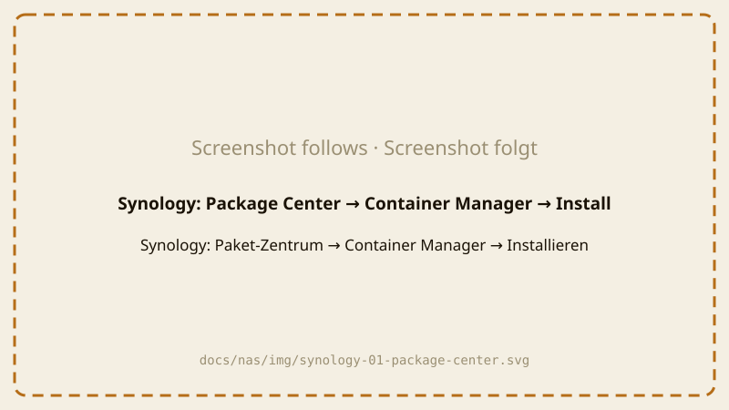
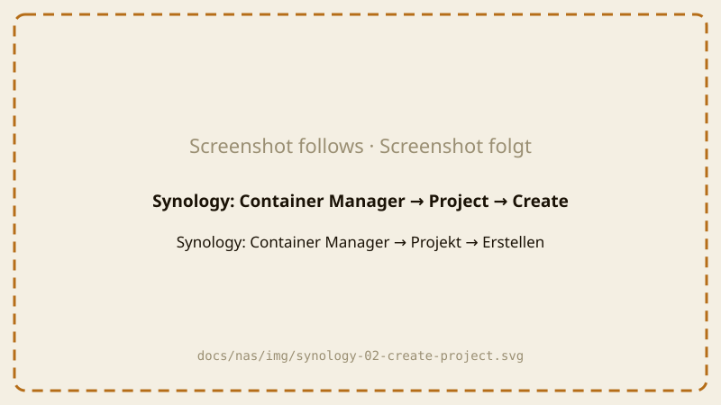
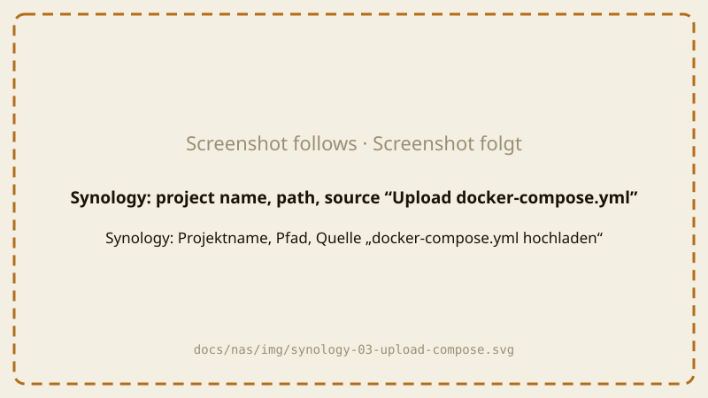
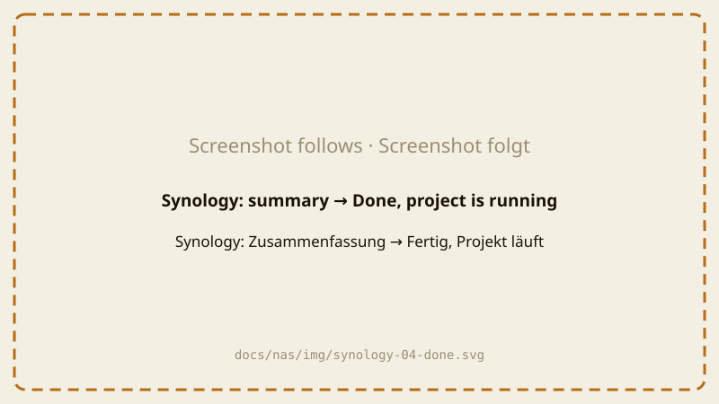
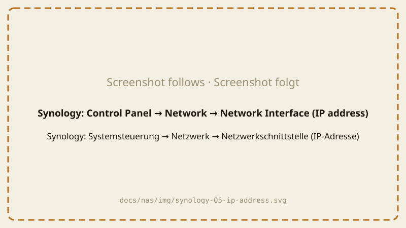
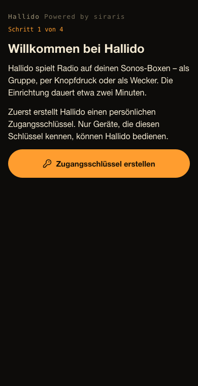
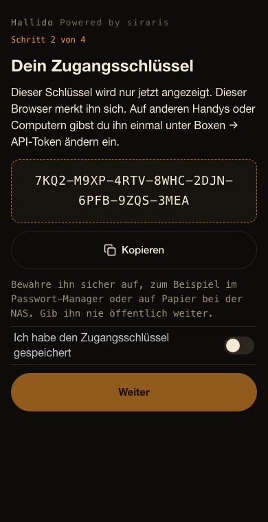
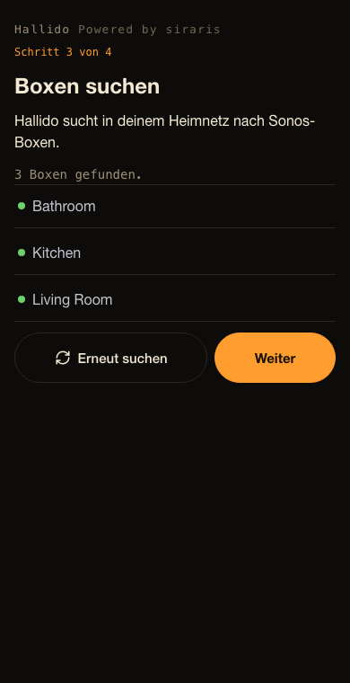
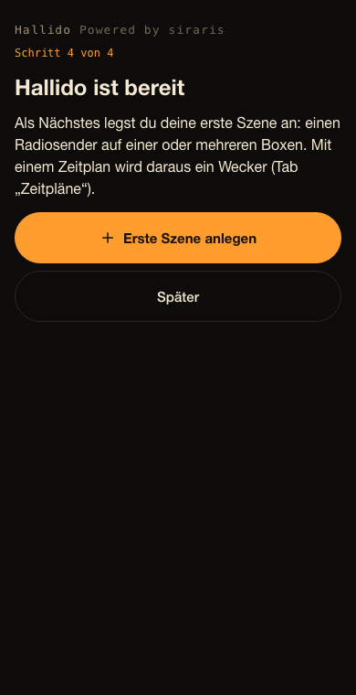

# Hallido auf einer Synology-NAS installieren

Für DSM 7.2 oder neuer. Dauert etwa 10 Minuten.

Du brauchst die Datei **`compose.yaml`** aus
[dem neuesten Release](https://github.com/ohm-meter/hallido/releases/latest)
auf deinem Computer ([was ist das?](README.md#die-drei-schritte)).

> Die Bilder sind Platzhalter und werden durch echte Screenshots ersetzt.

## Schritt 1: Container Manager installieren

1. Melde dich im Browser als Administrator an deiner Synology (DSM) an.
2. Öffne das **Paket-Zentrum**.
3. Suche nach **Container Manager** und klicke auf **Installieren**.
   Ist er schon installiert, mach mit Schritt 2 weiter.

## Schritt 2: Hallido-Projekt anlegen

1. Öffne den **Container Manager** (Hauptmenü oben links).
2. Klicke links auf **Projekt** und dann auf **Erstellen**.

   

3. Fülle das Formular aus:
   - **Projektname:** `hallido`
   - **Pfad:** klicke auf **Pfad festlegen**, wähle den Ordner **docker**,
     klicke auf **Ordner erstellen**, nenne ihn `hallido` und wähle ihn aus.
   - **Quelle:** wähle **docker-compose.yml hochladen** und wähle die
     heruntergeladene Datei `compose.yaml`.

   

4. Klicke auf **Weiter**. Wirst du nach **Webportal-Einstellungen** (Web
   Station) gefragt, ändere nichts und klicke wieder auf **Weiter**.
5. Lass auf der Zusammenfassung **Projekt nach der Erstellung starten**
   angehakt und klicke auf **Fertig**.

Die NAS lädt Hallido jetzt herunter (etwa 12 MB) und startet es. Zeigt das
Fenster **Exit Code: 0** oder das Projekt ein grünes **Wird ausgeführt**, ist
es fertig.

## Schritt 3: Adresse der NAS herausfinden

Wahrscheinlich kennst du sie schon – es ist die Adresse, mit der du DSM
öffnest, ohne `:5000`. Sonst: **Systemsteuerung → Netzwerk →
Netzwerkschnittstelle**. Die Adresse sieht aus wie `192.168.1.20`.

## Schritt 4: Hallido im Browser einrichten

Weiter mit [Hallido einrichten](#hallido-einrichten) unten.

---

## Hallido einrichten

Mach das **innerhalb einer Stunde**, nachdem Hallido gestartet ist (zu
deiner Sicherheit). Ist die Zeit abgelaufen, starte das Projekt neu:
Container Manager → **Projekt** → `hallido` → **Aktion** → **Neu starten**.

1. Öffne auf einem Handy oder Computer **in deinem Heimnetz**
   `http://192.168.1.20:8790` – mit der Adresse deiner NAS statt
   `192.168.1.20`. Nimm `http://`, nicht `https://`.
2. **Schritt 1 von 4:** tippe auf **Zugangsschlüssel erstellen**.

   

3. **Schritt 2 von 4:** dein Zugangsschlüssel wird angezeigt – **nur dieses
   eine Mal**. Tippe auf **Kopieren** und speichere ihn im Passwort-Manager,
   oder schreib ihn auf. Schalte dann **Ich habe den Zugangsschlüssel
   gespeichert** ein und tippe auf **Weiter**.

   

4. **Schritt 3 von 4:** Hallido sucht deine Sonos-Boxen. Nach ein paar
   Sekunden siehst du sie in einer Liste. Tippe auf **Weiter**.

   

5. **Schritt 4 von 4:** tippe auf **Erste Szene anlegen** – wähle einen
   Radiosender und die Boxen und speichere. Oder tippe auf **Später**.

   

Fertig. Tipp: Leg die Seite auf den Startbildschirm (Browser-Menü → **Zum
Home-Bildschirm**), dann öffnet sich Hallido wie eine App.

**Auf einem anderen Handy oder Computer:** öffne dieselbe Adresse, geh in den
Tab **Boxen → API-Token ändern** und gib deinen Zugangsschlüssel ein.

Klappt etwas nicht? Siehe [Wenn etwas nicht klappt](troubleshooting.md).
