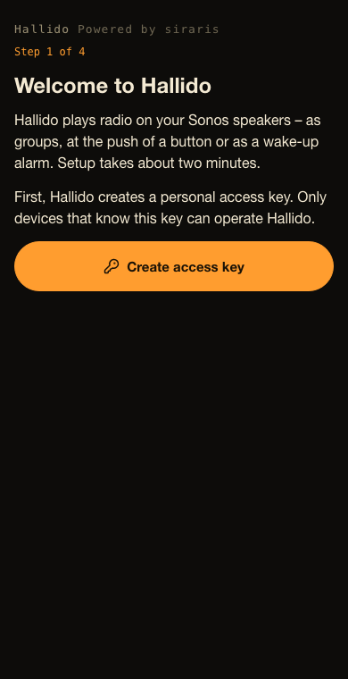
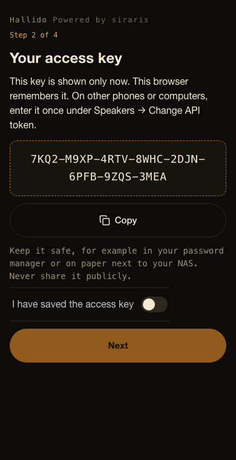
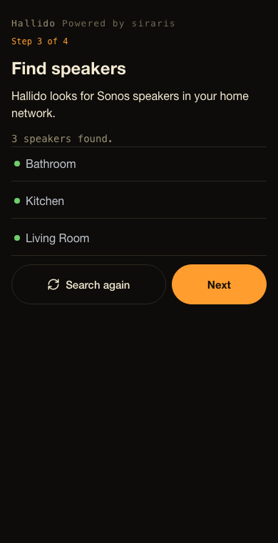
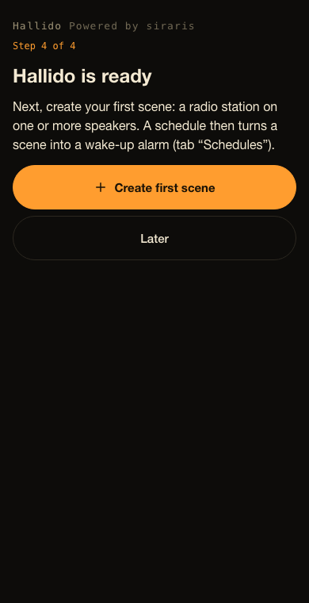

# Install Hallido on a Synology NAS

For DSM 7.2 or newer. Takes about 10 minutes.

You need the file **`compose.yaml`** from
[the latest release](https://github.com/ohm-meter/hallido/releases/latest)
on your computer ([what is that?](README.md#the-three-steps)).

> The pictures are placeholders and will be replaced by real screenshots.

## Step 1: Install Container Manager

1. Log in to your Synology (DSM) in the browser as an administrator.
2. Open **Package Center**.
3. Search for **Container Manager** and click **Install**.
   If it is already installed, go to step 2.

## Step 2: Create the Hallido project

1. Open **Container Manager** (main menu, top left).
2. Click **Project** on the left, then **Create**.

   

3. Fill in the form:
   - **Project name:** `hallido`
   - **Path:** click **Set path**, choose the folder **docker**, click
     **Create folder**, name it `hallido` and select it.
   - **Source:** choose **Upload docker-compose.yml** and select the file
     `compose.yaml` you downloaded.

   

4. Click **Next**. If you are asked about **Web portal settings** (Web
   Station), do not change anything and click **Next** again.
5. On the summary page leave **Start the project once it is created**
   ticked and click **Done**.

The NAS now downloads Hallido (about 12 MB) and starts it. When the window
shows **Exit Code: 0** or the project shows a green **Running**, it is ready.

## Step 3: Find the address of your NAS

You probably already know it – it is the address you use for DSM, without
`:5000`. Otherwise: **Control Panel → Network → Network Interface**. The
address looks like `192.168.1.20`.

## Step 4: Set up Hallido in the browser

Continue with [Set up Hallido](#set-up-hallido) below.

---

## Set up Hallido

Do this **within one hour** after Hallido started (for your security). If
the time is over, restart the project: Container Manager → **Project** →
`hallido` → **Action** → **Restart**.

1. On a phone or computer **in your home network**, open
   `http://192.168.1.20:8790` – with the address of your NAS instead of
   `192.168.1.20`. Use `http://`, not `https://`.
2. **Step 1 of 4:** tap **Create access key**.

   

3. **Step 2 of 4:** your access key is shown – **only this one time**.
   Tap **Copy** and save it in your password manager, or write it down.
   Then switch on **I have saved the access key** and tap **Next**.

   

4. **Step 3 of 4:** Hallido looks for your Sonos speakers. After a few
   seconds you see them in a list. Tap **Next**.

   

5. **Step 4 of 4:** tap **Create first scene** – choose a radio station and
   the speakers, and save. Or tap **Later**.

   

Done. Tip: add the page to your home screen (browser menu → **Add to Home
Screen**), then Hallido opens like an app.

**On another phone or computer:** open the same address, go to the tab
**Speakers → Change API token** and enter your access key.

Something not working? See [If something doesn't work](troubleshooting.md).
